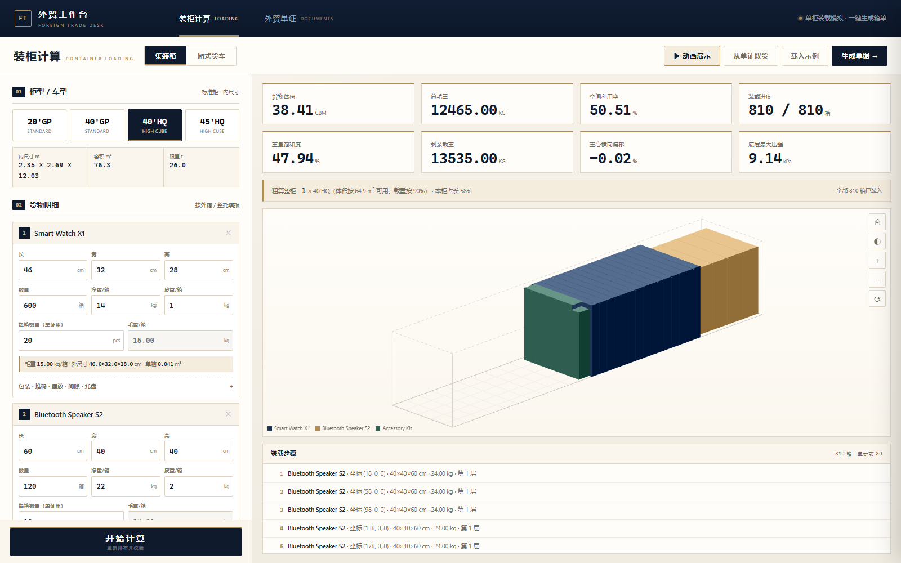

# 外贸工作台 · DSH 插件

把外贸单证、装柜计算与报价工作台接入 DeepSeek Harness Web UI。



## 功能

- **装柜计算**：20GP / 40GP / 40HQ / 45HQ、4.2–7.6 米货车；多货物、包装填充、堆码/承压、摆放方向、间隙、整托；CBM、毛净重、装载率、重量饱和度、重心偏移、底层压强
- **装柜动画**：按当前方案逐层播放，HUD 显示柜型、总箱数、箱规、层数与箱数；支持暂停 / 继续 / 重播
- **外贸单证**：报价单、PI、CI、销售合同、装箱单、出口报关单、代理报关委托书；A4 实时预览、整套打印、金额大写、定金/尾款拆分
- **卖方信息**：公司抬头、地址、税号、银行、Logo、公章、签名集中填写；保存后新建订单自动带出
- **导出**：装柜方案 PDF、单证 PDF、草稿 JSON

## 安装

### 从 npm

```bash
dsh plugin --profile <profile> add dsh-plugin-demian-trade-suite
```

或使用官方桌面端：Settings → Plugins，搜索 `dsh-plugin-demian-trade-suite` 安装。刷新 DSH Web GUI 后，左侧栏出现 **「外贸工作台」**。

### 从 GitHub Release（推荐）

1. 下载 [最新 Release](https://github.com/southcul/demian-trade-suite-dsh-plugin/releases) 里的 `demian-trade-suite-dsh-plugin.zip`
2. 解压，得到 `demian-trade-suite-plugin/` 目录
3. 打开 DSH **Plugin Manager → 安装本地 bundle**，选择这个目录
4. 刷新 DSH Web GUI，左侧栏出现 **「外贸工作台」**

### 从源码

```bash
git clone https://github.com/southcul/demian-trade-suite-dsh-plugin.git
```

然后在 DSH Plugin Manager 里选择仓库根目录安装 bundle，刷新页面。

## 使用

点击左侧栏的「外贸工作台」图标，中间栏会打开完整工作台：

- 顶部切换 **装柜计算 / 外贸单证**
- 装柜页点「载入示例」或「开始计算」播放动画
- 单证页顶部「卖方信息」填一次并保存，之后自动带出
- 单证页右上「预览并打印 A4 单据」

## 结构

| 文件 | 作用 |
|---|---|
| `index.js` | Host 半：在 DSH 同源 Web 服务上提供 `/plugins/demian-trade-suite/workbench.html` |
| `client.js` | Client 半：左侧栏入口 + 中间栏 iframe 页面 |
| `assets/workbench.html` | 现有单文件工作台，原样打包 |
| `locale/*.json` | 插件标题 / 描述 |
| `icon.svg` | 插件图标 |
| `scripts/package.py` | 重新生成 Release zip |

## 数据与迁移

- 插件运行在 DSH 的 origin（默认 `http://127.0.0.1:13807`）。
- 直接双击 `workbench.html` 时是 `file://` origin；两者的 `localStorage` **不共享**。
- 需要迁移旧数据时，在旧版用「导出」保存草稿，再在插件版「导入」；卖方信息包含在草稿里。

## 说明与边界

- 现有版本是完整的单文件应用，本插件用**同源 iframe** 作为兼容层，避免重写单证、画布和打印逻辑。
- 切换到其他侧栏页面时 iframe 会被卸载；工作台会自动保存草稿，回来后会恢复。
- 插件只负责 UI 入口；Agent 出单技能需另装 [demian-trade-suite](https://github.com/southcul/demian-trade-suite)。
- 如果要完全贴合 DSH 主题的原生 React 面板，需要后续把工作台拆成组件。

## 开发

```bash
python scripts/package.py
```

产物：`dist/demian-trade-suite-dsh-plugin.zip`，只含安装需要的文件。

## License

MIT
